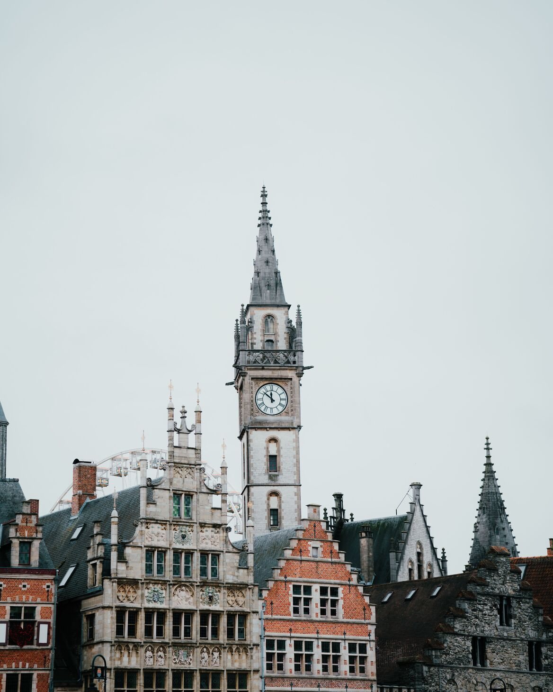
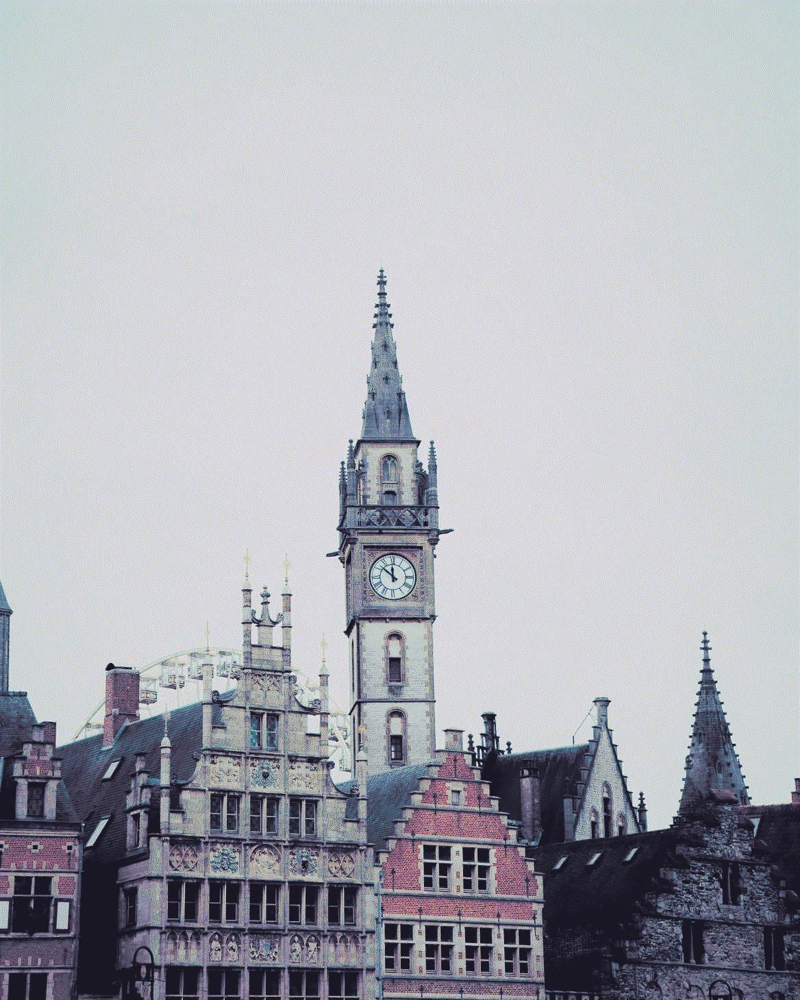
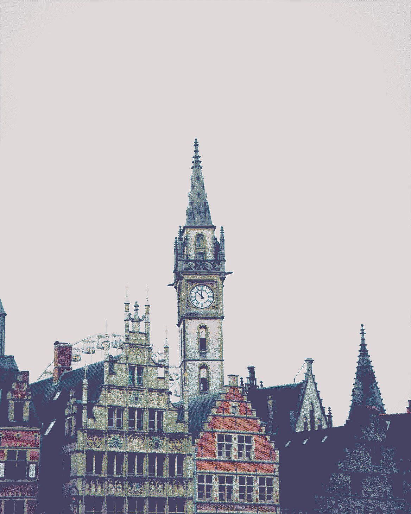
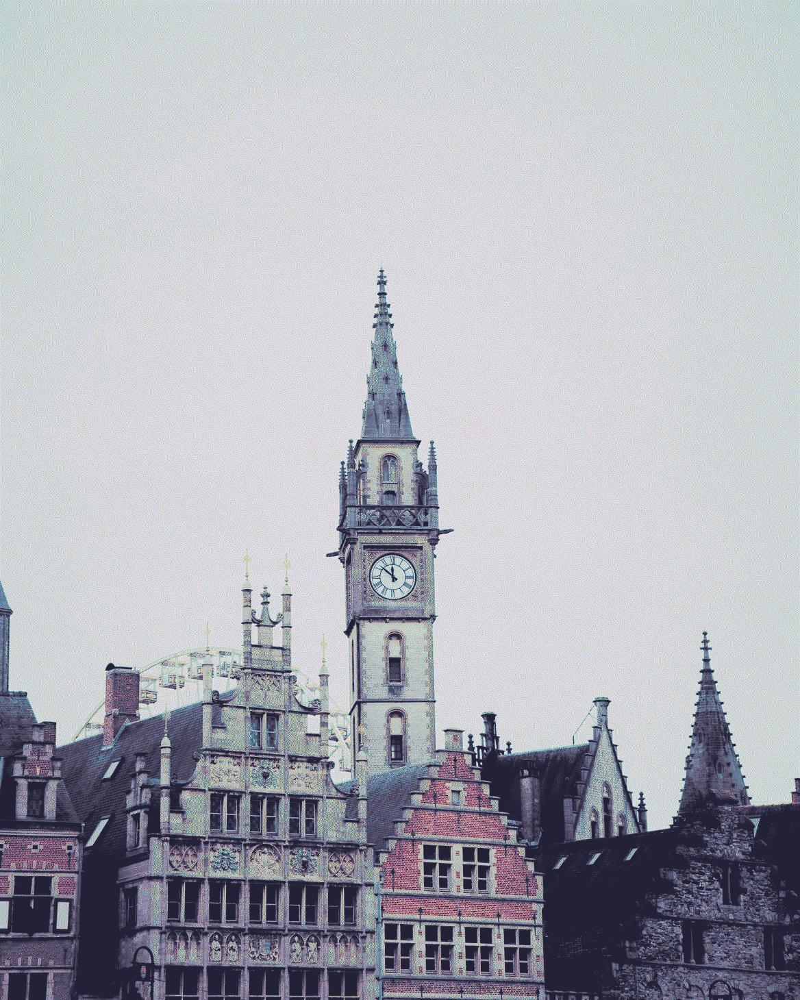

# pineforge
Transform any image to fit the Rose Pine palette, built in Rust

## Examples
<table>
  <tr>
    <td align="center"> Original</td>
    <td align="center"> Rose Pine</td>
    <td align="center"> Rose Pine Dawn</td>
    <td align="center"> Rose Pine Moon</td>
  </tr>
</table>

[image used](https://www.pexels.com/photo/historic-architecture-and-clock-tower-in-ghent-30223875/) by Danique Veldhuis

## Features
- All the official Rose Pine palettes
- Relatively fast

## Features to add
- Mixing colors from the palette with the one from the original image
- Bulk transform
- Ability to transform into all three palettes
