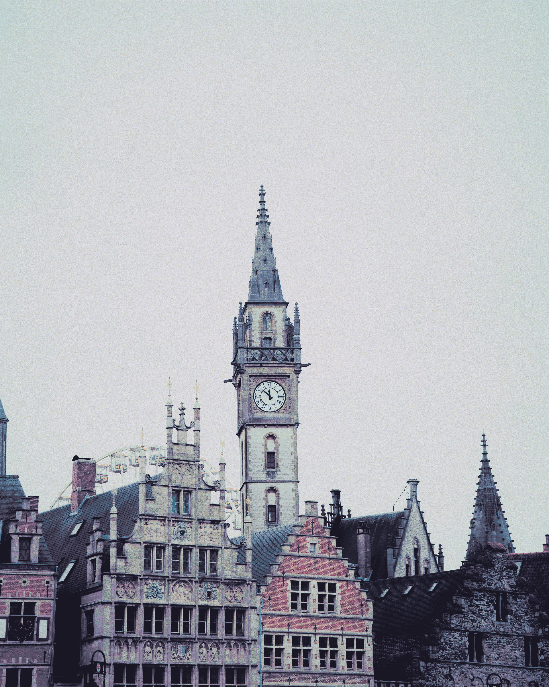

# pineforge
Transform any image to fit the Rose Pine palette

## Examples
<table>
  <tr>
    <td align="center" width="25%"> Original</td>
    <td align="center" width="25%"> Rose Pine</td>
    <td align="center" width="25%"> Rose Pine Dawn</td>
    <td align="center" width="25%"> Rose Pine Moon</td>
  </tr>
</table>

## Features
- All the official Rose Pine palettes
- Relatively fast

## Features to add
- Bulk transform
